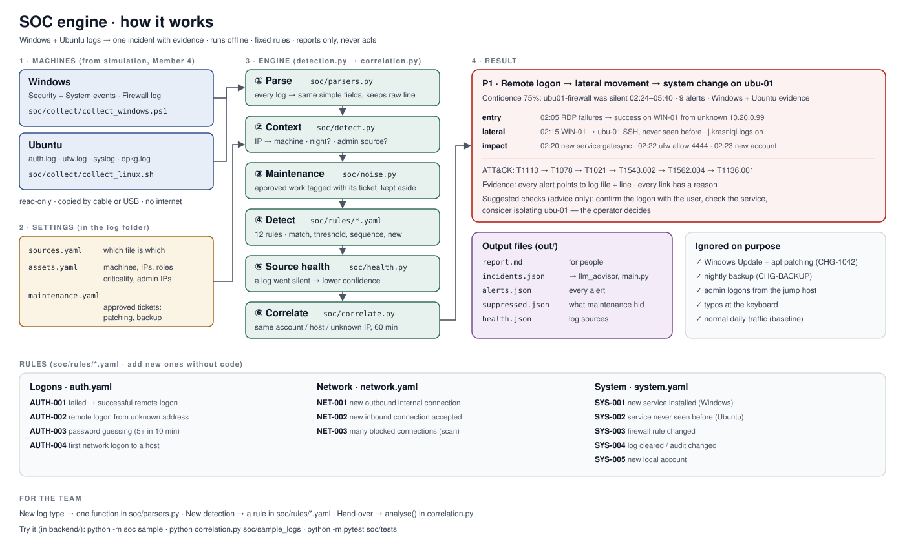

# Cyber Sentinels

**Local, explainable cyber defence for a military base.** Agents read the logs of each system, detect suspicious
behaviour with deterministic rules, join related events from different machines into **one prioritised incident**,
and a local AI model explains it to the operator. Everything runs offline on one workstation. The system only
**advises**: it never blocks, isolates or changes anything; the operator decides.

Built for the European Defence Tech Hackathon (EDTH) Prishtina 2026, Challenge 2: *Cyber Defence of Critical
Infrastructure Leveraging AI*.



## What it does

| | |
|---|---|
| **Reads** | Windows (Security/System events, firewall log) and Ubuntu (auth, ufw, syslog, dpkg) logs |
| **Detects** | 12 deterministic rules: failed→successful remote logons, password guessing, new internal connections, new services, firewall changes, cleared logs, new accounts |
| **Filters noise** | Approved patching and backups (maintenance calendar) and a learned baseline of normal behaviour |
| **Correlates** | Alerts sharing an account, host or unknown address in time → one incident: entry → lateral movement → impact |
| **Explains** | Evidence down to the raw log line, MITRE ATT&CK mapping, confidence (lowered when a log source goes silent), suggested checks |
| **Advises (local AI)** | Qwen3 via Ollama summarises the incident for the operator; it never decides what is an attack |
| **Threat intel** | OSINT agent matches outside findings to the base's assets |

## Architecture

```
 logs (Windows, Ubuntu, simulated sources)
        │
        ▼
 backend/detection.py ── backend/soc/ ── rules, maintenance filter, source health      (Member 2)
        │
        ▼
 backend/correlation.py ─ incidents + evidence + ATT&CK + confidence                     (Member 2)
        │                          ▲
        │                          └─ backend/osint_agent.py ─ threat intel              (Member 1)
        ▼
 AI_Log_Analyzer/ ─ local Qwen3 (Ollama) explanation, advisory only                     (Member 3)
        │
        ▼
 frontend/ ─ desktop dashboard (Tkinter): incidents, timeline, evidence, health          (Member 5)

 simulation/ ─ isolated VMware lab, log generation and replay, test scenarios           (Member 4)
```

## Quick start

Requires Python 3.11+. Run everything from the repository root.

```bash
python -m venv .venv
.venv\Scripts\activate                     # Linux/macOS: source .venv/bin/activate
pip install -r requirements.txt

python -m frontend                         # desktop dashboard on the sample logs
python backend/correlation.py backend/soc/sample_logs   # SOC report in backend/soc/sample_logs/out/

# 50-device synthetic base (2 days, 4 attacks, maintenance, a silent log source):
python backend/soc/fleet/make_fleet.py
python -m frontend --logs backend/soc/fleet/logs
```

Optional local AI (offline):

```bash
ollama pull qwen3:4b
ollama serve
```

Settings are read from environment variables; see [.env.example](.env.example). Defaults work on one machine.

## Tests

```bash
# Windows PowerShell:  $env:PYTHONPATH = "backend"     Linux/macOS:  export PYTHONPATH=backend
python -m pytest frontend/tests AI_Log_Analyzer/test_validation.py backend/soc/tests -q
```

The same tests run on every push (GitHub Actions). They cover the challenge's success criteria: all attack steps in
one incident, flagged in under 10 minutes, no false incidents without an attack, patching and backup suppressed,
lower confidence when a log source is missing, and no automatic actions.

## Repository layout

| Folder | Owner | Contents |
|---|---|---|
| [`backend/soc/`](backend/soc/README.md), `detection.py`, `correlation.py` | Member 2: SOC Detection & Correlation | Log parsers, rules, noise filter, correlation, log collectors, tests; [`backend/soc/fleet/`](backend/soc/fleet/README.md): 50-device synthetic base |
| `backend/osint_agent.py`, `backend/data/` | Member 1: OSINT & Threat Intelligence | Threat findings, asset inventory, cached KEV/NVD data |
| [`AI_Log_Analyzer/`](AI_Log_Analyzer/) | Member 3: Local AI & Incident Response | Local Ollama explanations, EN/SQ summaries, schema validation |
| `simulation/` | Member 4: VMware Simulation & Testing | Isolated lab, log generation and replay, scenarios |
| [`frontend/`](frontend/README.md), `backend/main.py` | Member 5: Dashboard & Integration | Desktop dashboard and integration |

## Ground rules

- **Local only:** no cloud services; the AI model runs on our own hardware.
- **Deterministic detection:** rules decide what is suspicious; the language model only explains.
- **Advice only:** no automatic blocking, isolation or configuration changes.
- **Synthetic or lab data only:** never commit real logs, credentials or personal data.

## License

[MIT](LICENSE)
