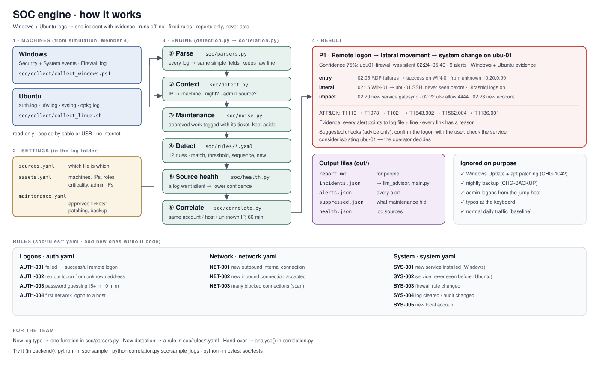

# SOC engine (Member 2: SOC Detection & Correlation)

Detection and correlation for **Windows and Ubuntu** logs. It reads the logs, finds suspicious behaviour with
fixed rules, ignores approved maintenance, joins related events from different machines into **one incident**,
and keeps the evidence for every step.

Runs locally and offline (Python only, no network calls). It only **reports**: it never blocks, isolates or
changes anything on any machine. The operator decides.



## Quick start (from the `backend/` folder)

```bash
python -m venv .venv
.venv\Scripts\activate                 # Ubuntu: source .venv/bin/activate
pip install -r soc/requirements.txt

python -m soc sample                   # sample logs (Windows + Ubuntu, 48 h) in soc/sample_logs
python detection.py soc/sample_logs    # stage 1: alerts
python correlation.py soc/sample_logs  # stage 2: incidents -> soc/sample_logs/out/report.md + JSON
python -m soc replay soc/sample_logs   # how fast is the incident flagged?
python -m pytest soc/tests -v          # check everything works
```

## For the other parts of the project

```python
from detection import detect        # backend/detection.py
from correlation import analyse     # backend/correlation.py

alerts = detect("soc/sample_logs")["alerts"]
incidents = analyse("soc/sample_logs")["incidents"]   # JSON-ready: for llm_advisor.py and main.py
```

## How it works

| Step | File | What it does |
|---|---|---|
| 1. Parse | `soc/parsers.py` | Turns each log type into events with the same simple fields (`time, host, user, src_ip, dst_ip, action…`). Every event keeps its file, line number and original text (evidence) |
| 2. Context | `soc/detect.py` (`enrich`) | Adds: IP → known machine and role, internal or internet, night or day, admin source, how critical the host is, visitor on a public service |
| 3. Maintenance | `soc/noise.py` | Events covered by an approved change ticket (patching, backup, scans) are tagged and kept aside, never deleted. Network-sensor flows are judged by the machines at both ends |
| 4. Detect | `soc/detect.py` + `soc/rules/*.yaml` | Runs the rules (see below) |
| 5. Source health | `soc/health.py` | Notices when a log stops writing at a time of day it normally writes (learned from the baseline), so the incident can say it may be missing events. A log that is quiet every night is not silent |
| 6. Correlate | `soc/correlate.py` | Links alerts with the same account, unknown address or host within 60 min into one incident: entry → execution → lateral movement → command and control → impact. Weak alerts (severity < 5) link only by account or unknown address, so a busy server cannot glue unrelated alerts together. Adds ATT&CK, a score (P1–P3), a confidence with reasons, and suggested checks |
| 7. Report | `soc/report.py` | `report.md` for people; `incidents.json`, `alerts.json`, `suppressed.json`, `health.json` for other tools |

## Logs it reads

| Machine | Log | Parser | Collect with |
|---|---|---|---|
| Windows | Security + System events (JSON lines) | `windows_events` | `soc/collect/collect_windows.ps1` |
| Windows | Firewall log `pfirewall.log` | `windows_firewall` | same script |
| Ubuntu | `/var/log/auth.log` (SSH, sudo, new users) | `linux_auth` | `soc/collect/collect_linux.sh` |
| Ubuntu | `/var/log/ufw.log` (firewall) | `linux_ufw` | same script |
| Ubuntu | `/var/log/syslog` (services started) | `linux_syslog` | same script |
| Ubuntu | `/var/log/dpkg.log` (updates) | `linux_dpkg` | same script |
| Windows | Sysmon: process created (1), network connection (3), file created (11), JSON lines | `windows_sysmon` | export like the Security log |
| Network sensor | Zeek `conn.log` (JSON or default TSV) | `zeek_conn` | Zeek on a SPAN/mirror port |
| Mail gateway | Verdict log, JSON lines (`ts, direction, client_ip, from, to[], subject, attachments[], verdict, action`) | `mail_gateway` | gateway export |

See `soc/collect/README.md` for the one-time setup on each machine.

## Rules (`soc/rules/*.yaml`)

| Rule | Detects | ATT&CK |
|---|---|---|
| AUTH-001 | Failed, then successful remote logon (RDP or SSH) | T1110, T1078 |
| AUTH-002 | Remote logon from an address not in `assets.yaml` | T1078 |
| AUTH-003 | Password guessing: 5+ failures in 10 min | T1110.001 |
| AUTH-004 | First network logon of an account to a host | T1021 |
| NET-001 | New outbound connection to an internal machine | T1021 |
| NET-002 | New inbound connection accepted (outside visitors on a port in `public_services` are normal) | T1021 |
| NET-003 | 20+ blocked connections from one address in 10 min | T1046 |
| NET-004 | Workstation connects straight to the internet, not via the proxy | T1071.001 |
| NET-005 | Beaconing: 6+ connections from a workstation to one internet address in 60 min (sensor) | T1071.001, T1573 |
| NET-006 | Traffic to an internal service port never used in the baseline (sensor) | T1571 |
| PROC-001 | Office application starts PowerShell/cmd/script host (Sysmon) | T1204.002, T1059.001 |
| PROC-002 | Encoded or hidden PowerShell command (Sysmon) | T1059.001 |
| PROC-003 | Scheduled task created by a user account (Windows 4698) | T1053.005 |
| PROC-004 | Program file written into a user profile (Sysmon) | T1105 |
| MAIL-001 | Mail with a risky attachment (.docm, .js, .iso, …) delivered to a user | T1566.001 |
| SYS-001 | New service installed (Windows) | T1543.003 |
| SYS-002 | Service started that never ran before (Ubuntu) | T1543.002 |
| SYS-003 | Firewall rule or setting changed | T1562.004 |
| SYS-004 | Security log cleared or audit policy changed | T1070.001, T1562.002 |
| SYS-005 | New local account created | T1136.001 |

"New" / "never before" means: not seen during the baseline (the first 24 h of logs). Night hours raise the severity.

**Add a rule:** add it to a YAML file in `soc/rules/`. Four types: `match` (one event), `threshold` (N events in a
window), `sequence` (steps in order, same values), `new_value` (never seen in the baseline). No code needed.

**Add a log type:** write one `parse_...` function in `soc/parsers.py` and add it to `PARSERS`.

## Settings (in the log folder)

| File | Contains |
|---|---|
| `sources.yaml` | Which file is which: parser, host, `utc_offset` for logs in local time, how often it normally writes |
| `assets.yaml` | Known machines: host, IP, role, criticality (1–5); admin IPs; night hours; optional `internal_nets` (CIDRs, default the private ranges) and `public_services` (`[{host, ports}]`: ports a server offers to the internet on purpose) |
| `maintenance.yaml` | Approved change tickets: hosts, time window, and what each is allowed to do |

Start from the files in `soc/sample_logs/` (2 machines). For a full base (50 devices, 2 days, 4 attacks, maintenance, a
silent log source, answer key) run `python backend/soc/fleet/make_fleet.py`: see [`fleet/README.md`](fleet/README.md). Later the machine list can come from `backend/data/assets.json` (Member 1).

## Output for the rest of the project

`analyse()` in `backend/correlation.py` (or `out/incidents.json`) is the hand-over to `llm_advisor.py` (Member 3) and `main.py` / the dashboard (Member 5). Each incident has:
`id, priority, score, title, start, end, stages, confidence, confidence_reasons, hosts, users, unknown_ips,
attack (ATT&CK techniques), alerts (each with its raw evidence lines), links (why they belong together), next_checks`.

## Tested (sample logs: Windows laptop + Ubuntu server)

| Criterion | Result |
|---|---|
| Whole attack (entry → lateral movement → impact) in one incident | ✅ 1 incident, P1, 9 alerts from Windows and Ubuntu |
| Time to flag after the last event | ✅ within the same minute (target < 10 min) |
| False incidents without an attack | ✅ 0 |
| Patching and backup | ✅ fully suppressed, attacker inside the patch window still found |
| A log source goes silent | ✅ still detected; confidence 75% with the reason |
| No automatic action | ✅ a test checks the engine cannot run commands, delete files or use the network |
| Speed | ✅ ~0.2 s for 48 h of logs |

## Layout

```
backend/
  detection.py          stage 1 entry point: alerts
  correlation.py        stage 2 entry point: incidents
  soc/
    parsers.py          Windows + Ubuntu logs -> common events
    detect.py           context + rule engine
    noise.py            approved maintenance kept aside
    health.py           silent log sources
    correlate.py        incidents, evidence, confidence, suggested checks
    pipeline.py         runs the two stages
    report.py           report.md + JSON
    attack.py           local MITRE ATT&CK table
    sample.py           sample log generator
    sample_logs/        generated sample logs + settings
    rules/              detection rules (YAML)
    collect/            read-only log collectors (Windows, Ubuntu)
    tests/              test_soc.py
    docs/               soc-map.svg
```
